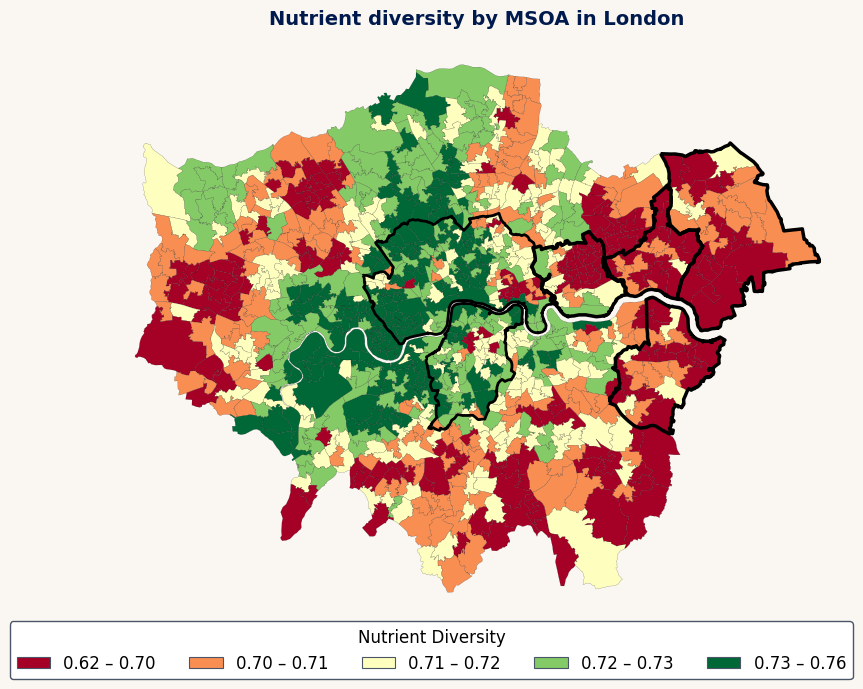
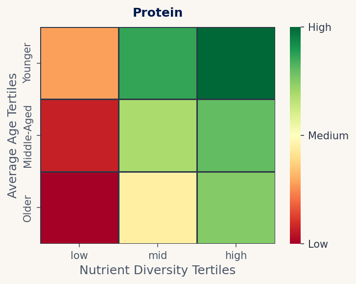
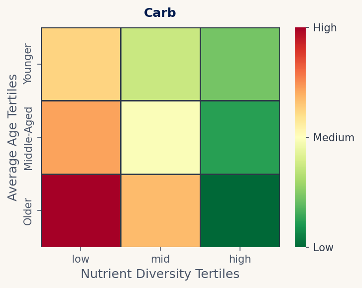
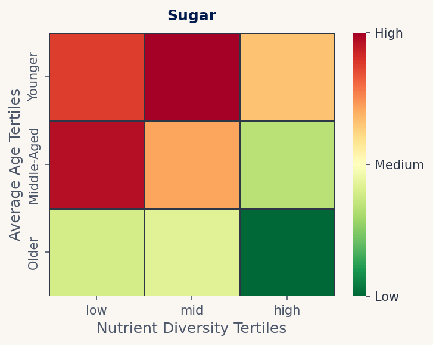
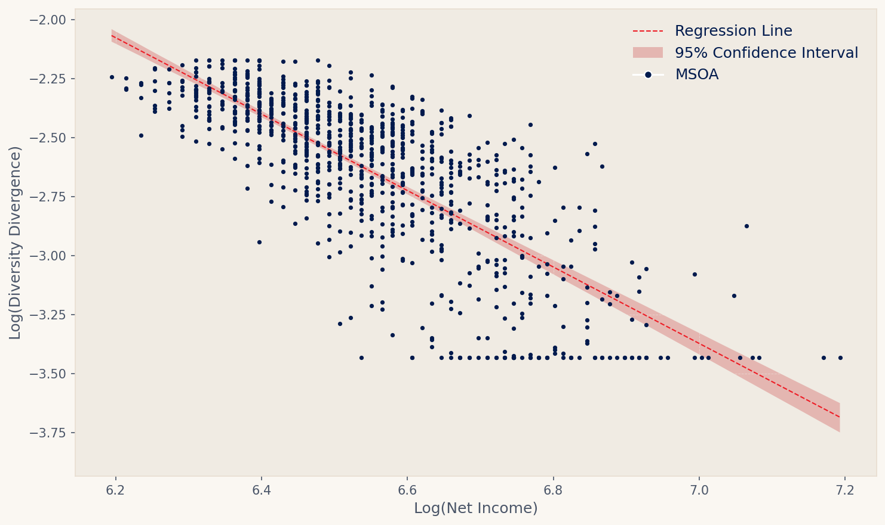

# Tesco Clubcard: Nutrient Diversity in London

An MSc Data Science group coursework project investigating geographical inequalities in nutrient diversity across London using Tesco Grocery 1.0 purchasing data, statistical analysis and geospatial techniques.

## Project Overview

This project investigates whether the variety of foods purchased reflects nutritional diversity and how purchasing patterns differ across London.

Using 2015 Tesco Clubcard purchasing data aggregated at Middle Layer Super Output Area (MSOA) level, the analysis explores geographical differences in nutrient diversity, relationships with macronutrient diversity, and the association between household income and the gap between basket diversity and nutrient diversity.

The analysis combines Tesco Grocery 1.0 data with 2014 ONS Small Area Income Estimates.

## Research Questions

1. Where are the geographical gaps in nutrient diversity across London?
2. How are macronutrient diversity and average age associated with nutrient diversity?
3. How does household income relate to the difference between basket diversity and nutrient diversity?

## Dataset Overview

**Tesco Grocery 1.0**
- 983 London MSOAs.
- More than 420 million purchase records.
- 17 food categories and over 30 nutrients.
- 202 variables covering purchasing patterns, demographics and nutritional information.
- Annual purchasing data for 2015.

**ONS Small Area Income Estimates**
- 2014 net weekly income estimates before housing costs.
- 7,201 MSOAs across England and Wales, with the London subset used in the analysis.
- Income estimates using the OECD equivalisation scale.

## Methodology

- **Data processing:** Cleaning, transformation and aggregation of grocery purchasing data at MSOA level.
- **Nutrient diversity:** Shannon entropy used to measure diversity in nutrient purchasing patterns.
- **Statistical analysis:** Descriptive statistics, correlation and OLS regression with HC3 robust standard errors.
- **Geospatial analysis:** MSOA-level geographical comparisons and choropleth mapping.
- **Income analysis:** Regression examining the relationship between log-transformed income and basket–nutrient diversity divergence.
- **Visualisation:** Statistical plots, geographical maps and Power BI.

## Key Findings

### 1. Geographical inequalities

- Inner London generally demonstrates higher nutrient diversity.
- Lower-diversity areas cluster in outer East and South London.
- Bexley, Barking and Dagenham, Havering and Newham are identified as areas with lower average nutrient diversity.

### 2. Macronutrient diversity

The OLS model explains approximately 51% of the variation in nutrient diversity (R² = 0.51).

| Predictor | Coefficient |
|---|---:|
| Carbohydrate diversity | -0.058 |
| Sugar diversity | -0.013 |
| Protein diversity | +0.025 |
| Average age | +0.015 |

Protein diversity and average age have positive associations with nutrient diversity, while carbohydrate and sugar diversity have negative associations.

### 3. Income and basket–nutrient divergence

The analysis defines diversity divergence as:

`Basket Diversity − Nutrient Diversity`

The income regression reports R² = 0.59 and a log-income coefficient of -1.62 (p < 0.001).

Lower-income MSOAs show a larger gap between basket diversity and nutrient diversity.

## Assumptions and Limitations

- **Clubcard representation:** Clubcard holders may not represent all grocery shoppers.
- **Full grocery basket assumption:** Tesco purchases are treated as representative of household grocery purchasing, although purchases from other retailers and markets are not captured.
- **Average nutrient profiles:** Individual nutritional differences between products within a food category are not fully captured.
- **Geographical coverage:** Findings are specific to London and should not automatically be generalised nationally.
- **Temporal mismatch:** 2014 income estimates are compared with 2015 purchasing data.
- **Outlier treatment:** The income analysis applies asymmetric winsorisation, capping 6.5% of lower values and 1% of upper values.

## Tools and Technologies

Python | Pandas | NumPy | SciPy | Statsmodels | Matplotlib | Seaborn | GeoPandas | Power BI | Jupyter Notebook

## Repository Structure

```text
tesco-clubcard-nutrient-diversity/
├── README.md
├── requirements.txt
├── data/
│   └── README.md
├── notebooks/
│   └── tesco_nutrient_diversity_analysis.ipynb
└── visualisations/
    ├── README.md
    ├── nutrient_diversity_map.png
    ├── heatmap_protein.png
    ├── heatmap_carbohydrate.png
    ├── heatmap_sugar.png
    └── income_diversity_scatterplot.png
```

## Data Sources

- [Tesco Grocery 1.0 – Figshare](https://figshare.com/collections/Tesco_Grocery_1_0/4769354)
- [ONS Small Area Model-Based Income Estimates](https://www.ons.gov.uk/employmentandlabourmarket/peopleinwork/earningsandworkinghours/datasets/smallareaincomeestimatesformiddlelayersuperoutputareasenglandandwales)

See [`data/README.md`](data/README.md) for dataset documentation and access information.

Original datasets are not redistributed in this repository.

## Reproducibility

See [`requirements.txt`](requirements.txt) for the Python dependencies.

The notebook expects the required datasets to be placed in `data/raw/`. Refer to the notebook for the expected filenames and analysis workflow.

End-to-end execution has not yet been verified in a clean environment.

## Academic Context

Developed as group coursework for CM52052 Applied Data Science, MSc Data Science, University of Bath.


## Project Visualisations

### 1. Geographical distribution of nutrient diversity



### 2. Macronutrient diversity analysis

The heatmaps explore protein, carbohydrate and sugar diversity across age and nutrient-diversity groups.







### 3. Income and nutrient diversity divergence


